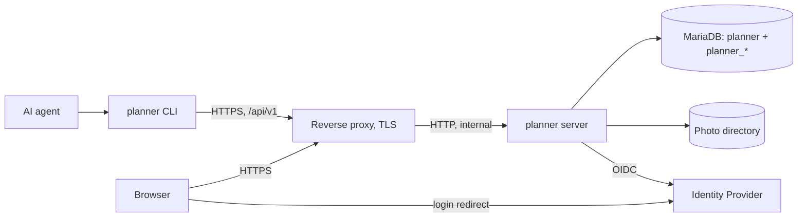

# Architecture

## Overview

planner is one Rust server process and one Rust CLI (NFR-ARCH-001, NFR-ARCH-002). The server exposes the WEB API and the WEBSITE (FR-PLT-001…004) and persists to one MariaDB instance (NFR-ARCH-004). Source ids `[Sn]` refer to the [source register](database-schema.md#sources). Decider key: [README.md](README.md#conventions).

## Decisions

| # | Decision | Rationale | By |
|---|----------|-----------|----|
| A1 | Exactly one server instance runs against a database instance. Running several is not supported. | Removes cross-instance coordination from crash recovery, migrations and rate limiting. NFR-PERF-002 (200 req/s) is within one process's reach; the performance test confirms it ([testing.md](testing.md#performance-test)). | U |
| A2 | Web framework: axum 0.8.9 on tokio 1.54.1 [S28, S30]. | axum works with tokio and hyper and uses `tower::Service` as middleware, so request id, timeouts and rate limiting are layers, not framework features [S30]. | U |
| A3 | Database access: sqlx 0.9.1, MySQL driver, hand-written SQL [S28, S29]. No ORM. | sqlx lists MariaDB as supported [S29]. Hand-written SQL keeps the locking reads of [data-integrity-and-concurrency.md](data-integrity-and-concurrency.md) explicit. | U |
| A4 | WEBSITE: server-side HTML with askama 0.16.1 templates and htmx 4.0.2; Kanban drag and drop with vendored SortableJS 1.15.7; Gantt chart rendered by the server as SVG [S28, S31, S34, S35]. | askama compiles templates into the binary at build time [S31], so template errors fail the build. No JavaScript build toolchain is needed. htmx 4.0.2 is the newest release; npm still marks 2.0.11 `latest` until 2027 [S34]. | U |
| A5 | Static assets (htmx, SortableJS, CSS) are vendored files embedded in the server binary and served by it. | One artefact to deploy ([operations.md](operations.md#packaging)); no CDN dependency. | U |
| A6 | The WEBSITE calls the server's service layer in-process. It is not a client of `/api/v1`. | `/api/v1` is token-authenticated ([web-api.md](web-api.md#authentication)); WEBSITE requests are session-authenticated ([security.md](security.md#website-sessions)). Both reach the same services, so every rule is enforced once. | B |
| A7 | The CLI is a separate Rust binary using clap 4.6.9 [S28, S32]. | [cli.md](cli.md). | B |
| A8 | Libraries [S28]: `time` 0.3.55 for dates and date-times; `openidconnect` 4.1.0 for OIDC; `reqwest` 0.13.5 with `rustls` for the CLI's HTTP and the server's IdP calls; `image` 0.25.10 for photos; `governor` 0.10.4 for rate limiting. | sqlx maps `time::Date` to `DATE` and `time::PrimitiveDateTime` to `DATETIME` [S29], matching D6. Choices per library: [security.md](security.md), [cli.md](cli.md), [below](#user-photo-storage). | U |

## Components

| Component | Responsibility |
|-----------|----------------|
| Domain | Types and invariants of [domain-model.md](domain-model.md). No I/O. |
| Services | One function per use case. Opens the transaction, runs the [permission check](data-integrity-and-concurrency.md#permission-check-in-writes), takes the locks, enforces the rules, writes the audit entries (L5). |
| Persistence | SQL per table, over the pool ([below](#database-access)). |
| WEB API | axum routes under `/api/v1`: JSON in and out, token authentication, mapping to problem details ([web-api.md](web-api.md)). |
| WEBSITE | axum routes rendering askama templates; htmx fragments; sessions, CSRF and OIDC login ([security.md](security.md)). |
| Photo store | Files in the photo directory ([below](#user-photo-storage)). |
| Startup | Instance guard, migrations, recovery ([below](#startup-sequence)). |

## Database access

| Rule | Content | Rationale | By |
|------|---------|-----------|----|
| DA1 | One sqlx pool, runtime account ([database-schema.md](database-schema.md#privileges)). Provisioning and migration use separate, short-lived connections. | One pool serves both kinds of database, so a transaction can span `planner` and `planner_<project>`. | U |
| DA2 | Every query uses fully qualified names: `` `planner`.`users` ``, `` `planner_<project>`.`work_items` ``. No connection issues `USE`. | A pooled connection carries no per-project state. The `<project>` part is a validated `ProjectName` (`^[a-z][a-z0-9_]{0,49}$`), so it is safe inside backquotes. | U |
| DA3 | Compile-time checked queries (`query!` family with cached data in `.sqlx`, checked in CI with `cargo sqlx prepare --check`) for central-database SQL. Project-database SQL uses the runtime-checked `query` functions. | `query!` accepts only a string literal [S29]; project SQL contains the database name chosen at runtime. Integration tests cover the project SQL ([testing.md](testing.md)). | U ("where feasible"), split: B |
| DA4 | Every connection runs with `time_zone = '+00:00'`. | NFR-DATA-001, [database-schema.md](database-schema.md#decisions) D6. This is the sqlx default (`timezone` = `Some("+00:00")`) [S29]; the server MUST NOT override it. | B |
| DA5 | Pool maximum: 32 connections, configurable ([operations.md](operations.md#configuration)). | Little's law: busy connections = arrival rate × mean hold time. At 200 req/s (NFR-PERF-002) and a conservative 50 ms mean hold time, about 10 are busy; simple operations (NFR-PERF-004) hold a connection for one short transaction (L6). 32 gives ≈ 3× headroom for bursts, lock waits and list operations, and stays below the MariaDB default `max_connections` of 151 [S11]. The performance test validates it. | B |
| DA6 | Prepared-statement cache: sqlx default, 100 statements per connection, LRU [S29]. | 32 × 100 = 3,200 server-side statements, below the default `max_prepared_stmt_count` of 16,382 [S11]. Project SQL differs per database name, so the cache holds the statements of recently used projects; a miss costs one extra prepare round trip. The performance test measures the effect. | B |
| DA7 | Pool acquire timeout: 2 s. A request that gets no connection within it fails with 503 `POOL_EXHAUSTED` ([web-api.md](web-api.md#status-mapping)). | Bounds the wait under overload instead of queueing past NFR-PERF-003. | U |
| DA8 | Each new connection runs `SET SESSION innodb_lock_wait_timeout = 5` (an sqlx `after_connect` action [S29]). | [database-schema.md](database-schema.md#required-server-settings); 1205 is retried under L4. | U |
| DA9 | TLS to MariaDB: `PLANNER_DB_SSL_MODE`, one of sqlx's `disabled`, `preferred`, `required`, `verify_ca`, `verify_identity` [S29]; default `disabled`. | User's choice for a local or private database network. With `disabled`, credentials and data cross the network in plaintext; when the database is not on the same host or a private network, operators SHOULD set `required`, or `verify_identity` with `PLANNER_DB_SSL_CA`. | U |

## Startup sequence

The server accepts no request until every step succeeds. A failing step ends the process with a non-zero exit code; the process supervisor restarts it, and the next start resumes (D16, recovery idempotence).

1. Read and validate the configuration ([operations.md](operations.md#configuration)).
2. **Instance guard.** Open a dedicated runtime-account connection, outside the pool, and run `SELECT GET_LOCK('planner.instance', 1)`; no privilege is needed [S48]. Result 1: continue, and keep this connection open for the process lifetime. Result 0 (timed out) or NULL: exit with an error naming a second instance. `GET_LOCK` names are server-wide and the lock is released when the connection terminates, normally or not [S25]. If the guard connection is lost while running, the server stops accepting requests and exits, because the lock is gone. (Guard and its behaviour: B, under the user's delegation.)
3. Open the migration connection. Migrate `planner` to the binary's version, including the runtime grants on new tables ([database-schema.md](database-schema.md#schema-versioning), D19).
4. Open the pool. Recover projects left in `provisioning` or `deleting` ([data-integrity-and-concurrency.md](data-integrity-and-concurrency.md#project-provisioning-and-deletion)). Recovery runs after step 3 because its code reads `projects` at the current schema, and before step 5 so that no half-created or half-dropped database is migrated.
5. Migrate every project database, ascending `projects.id`.
6. Close the migration connection. Check that every database is at the binary's version.
7. Run the [periodic tasks](#periodic-tasks) once.
8. Start the listener and report ready ([operations.md](operations.md#observability)).

Rationale for the guard (A1): single-instance operation is an assumption that a deployment error can break. Two instances would each run recovery on the other's live provisioning sequence and keep separate rate-limit counters. The guard turns that error into a refused start.

Startup time grows with the number of projects in step 5 when a migration is pending: the WEBSITE and WEB API are unavailable meanwhile.

### What several instances would require

Not supported (A1). Each item below would have to change first:

| Area | Single-instance design | Needed for several instances |
|------|------------------------|------------------------------|
| Crash recovery | At startup; every `provisioning`/`deleting` project is crashed. | A lease per sequence (owner instance, heartbeat) so that a live sequence is not recovered. |
| Migrations | At startup, by the only instance. | Serialisation across instances, and binaries that tolerate the previous and next schema during a rolling update. |
| Rate limiting | In-process counters ([security.md](security.md#rate-limiting)). | A shared store, or limits divided per instance. |
| Instance guard | `GET_LOCK` refuses a second process. | Removed. |
| OIDC pre-login state | Encrypted cookie ([security.md](security.md#oidc-login)). | The same cookie key on every instance. |
| Periodic tasks | Run by the only instance. | One runner, or tasks safe to run concurrently. |
| Photo directory | Local directory. | Storage shared by all instances. |

## Periodic tasks

A task in the server process runs every hour (U; interval: B) and once at startup (step 7). Each part is idempotent, so a crash mid-run is repaired by the next run.

| Part | Action | Source |
|------|--------|--------|
| Session purge | `DELETE` sessions whose `lastseendt` is older than the idle timeout; `DELETE` sessions whose `createddt` is older than the absolute timeout. | [security.md](security.md#website-sessions) |
| Photo sweep | Delete every file in the photo directory whose name is not the hex of a current `users.photo_key` and whose modification time is older than `PLANNER_PHOTO_DELETE_DELAY` (default 48 h). | [below](#user-photo-storage) |

## User photo storage

Requirement: FR-IDN-006, FR-IDN-007. Decisions U unless marked.

| Aspect | Rule |
|--------|------|
| Backend | Files in one directory, configured as `PLANNER_PHOTO_DIR` ([operations.md](operations.md#configuration)). |
| File name | Lowercase hex of `users.photo_key` (32 characters). The key is random and changes on each upload ([database-schema.md](database-schema.md#central-database-planner)). |
| Accepted input | PNG, JPEG or WebP, at most 2 MiB (2,097,152 bytes). The request body limit on the upload route enforces the size. The type is decided by content, never by file name or declared type: `image::ImageReader::with_guessed_format`, which guesses from the leading magic bytes [S49]; only `ImageFormat::Png`, `Jpeg` and `WebP` are accepted. Anything else is refused (400 `VALIDATION_FAILED`). |
| Processing | Decode with explicit `image::Limits` set on the reader: `max_image_width` and `max_image_height` 8,192, `max_alloc` 256 MiB (the defaults are no dimension limit and 512 MiB) [S49]. `Limits` is `#[non_exhaustive]` with public fields, so it is built from `Limits::default()` and then set [S49]. Input that exceeds a limit (`ImageError::Limits` [S49]) is refused with 400 `IMAGE_TOO_LARGE`. `max_alloc` is non-strict and some decoders may ignore it [S49]; the dimension limits are strict. Animated input (`has_animation` for WebP, `is_apng` for PNG) uses the first frame of the frame iterator (`into_frames`, `apng`) [S49]. Crop non-square input to its centred square; resize to 256 × 256 pixels; encode as lossless WebP (VP8L) with the `image` crate's `WebPEncoder::new_lossless`, the only WebP mode it offers; lossy would need libwebp [S49]. Pure Rust, no native library. Re-encoding from decoded pixels writes no input metadata. Served as `image/webp`. (U) |
| Access | Served by the server to any WEBSITE session and to any valid token (FR-AUTH-027), at the route in [web-api.md](web-api.md#resource-map). Never served from the directory by the reverse proxy. |
| Who may change it | The user, and administrators, through the WEBSITE only (FR-IDN-007). Audited as `modify` `user`. |
| Missing file | A key whose file is absent is served as "no photo" (404), never as an error page. |

Replacement order. Files are never deleted in the request; the [photo sweep](#periodic-tasks) deletes unreferenced files once they are older than the delay. A crash therefore leaves at most an unreferenced file and never a key without a file, and nothing but the filesystem and `users.photo_key` records what is pending.

1. Generate the new key. Write the processed image to a temporary file in the photo directory, flush it to disk, and rename it to the new key's name. Its modification time is now, so the sweep cannot delete it before step 3 commits.
2. Set the old file's modification time to now. The old file is still referenced, so this is harmless if the request fails; after step 3 it starts the delay.
3. In one transaction: set `users.photo_key` to the new key; insert the audit entry. Commit.

Removal of a photo: step 2 for the current file, then commit `photo_key = NULL` with its audit entry. A replaced or removed file thus survives at least `PLANNER_PHOTO_DELETE_DELAY` after the change, which keeps it available to a backup taken in that window ([operations.md](operations.md#backup-and-restore)). Temporary files left by a crash are swept by the same rule. (Mechanism: U; modification-time marking and order: B.)
