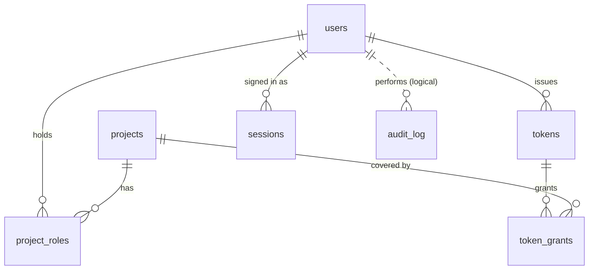
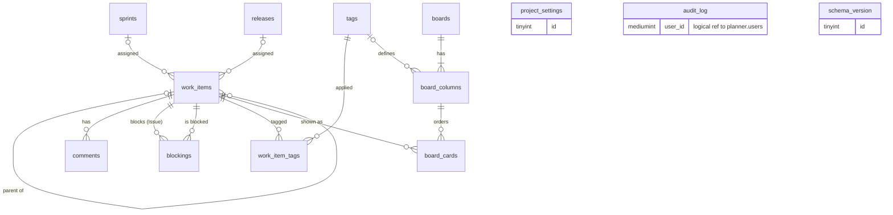

# Domain model

## Overview

These are the server's domain types, at modelling level, in Rust (NFR-ARCH-002). The model's only crate is `time` 0.3.55, behind `UtcDate` and `UtcDateTime` ([architecture.md](architecture.md#decisions) A8). Column definitions are in [database-schema.md](database-schema.md). Locks and multi-row rules are in [data-integrity-and-concurrency.md](data-integrity-and-concurrency.md).

Invariant placement key, used in every table below:

| Code | Where | Meaning |
|------|-------|---------|
| **T** | Type | Enforced by a constructor or by the type's shape. An invalid value cannot exist in memory. |
| **D** | Database | A declarative constraint (PK, UNIQUE, FK, CHECK, ENUM) rejects it. |
| **S** | Service | Checked by the application inside the writing transaction, under the locks given in [data-integrity-and-concurrency.md](data-integrity-and-concurrency.md#rule-enforcement). |

## Primitive and identifier types

```rust
pub struct UtcDate(time::Date);               // calendar date, UTC (FR-PLT-005); DATE
pub struct UtcDateTime(time::PrimitiveDateTime); // UTC by construction, whole seconds; DATETIME, NFR-DATA-001

// Ids: AUTO_INCREMENT, never reused, gaps allowed; width per entity (database-schema.md D2).
// u16 = SMALLINT UNSIGNED; u32 = MEDIUMINT UNSIGNED (checked ≤ 16,777,215) or INT UNSIGNED.
pub struct ProjectId(u16);     pub struct SprintId(u16);       pub struct ReleaseId(u16);
pub struct BoardId(u16);       pub struct BoardColumnId(u16);  pub struct TagId(u16);
pub struct UserId(u32);        pub struct ProjectRoleId(u32);  pub struct TokenId(u32);   // MEDIUMINT
pub struct WorkItemId(u32);                                                              // MEDIUMINT
pub struct CommentId(u32);                                                               // INT
pub struct AuditEntryId(u32);  // INT in project databases, MEDIUMINT in the central database
```

sqlx maps `time::Date` to `DATE` and `time::PrimitiveDateTime` to `DATETIME` [S29]. `PrimitiveDateTime` carries no offset; `UtcDateTime` is constructed only from a UTC instant truncated to whole seconds, so every value it holds is UTC (NFR-DATA-001).

Ids are distinct types, so ids of different entities cannot be confused at compile time. Project-scoped ids are unique only within their project (BR-PRJ-001). They are meaningful only together with the `ProjectId` of the request.

## Enumerations

Each variant maps one-to-one to the ENUM literal in the schema.

| Enum | Variants → DB literal | Source |
|------|-----------------------|--------|
| `WorkItemKind` | `Epic` `epic`, `Feature` `feature`, `UserStory` `userstory`, `Task` `task`, `Defect` `defect`, `Refactoring` `refactoring`, `Spike` `spike`, `Issue` `issue` | FR-WI-001 |
| `CommentKind` | `Hypothesis`, `Test`, `Finding`, `Decision`, `Progress`, `Update`, `Note`, `Question`, `FollowUp` (`FOLLOW-UP`), `Blocker`, `Handoff`, `Assumption`, `Risk`, `Review`, `Debt`. The literal is the upper-case name. | BR-CMT-001 |
| `SprintState` | `Planned`, `Active`, `Closed` | FR-SPR-005 |
| `Role` | `Owner`, `Member`, `Viewer` | FR-ACC-002, BR-ACC-001 |
| `TokenLevel` | `Read` `read`, `ReadWrite` `read+write` | FR-AUTH-006 |
| `AuditAction` | `Create`, `Modify`, `Delete` | audit-log.md Inputs / Outputs |
| `ProjectAuditEntity` | `WorkItem` `workitem`, `Comment`, `Tag`, `Board`, `Sprint`, `Release`, `Project` | FR-AUD-009, FR-AUD-015 |
| `PlatformAuditEntity` | `Project`, `User`, `Role`, `Token` | FR-AUD-007 |
| `BoardColumnKind` | `Open`, `Tag(TagId)`, `Closed`. In the database: `kind` + `tag_id`. | FR-KBN-002, FR-KBN-003 |
| `ProjectState` | `Provisioning`, `Active`, `Deleting` (technical, not part of the API) | [data-integrity-and-concurrency.md](data-integrity-and-concurrency.md#project-provisioning-and-deletion) |

`WorkItemKind` carries the kind-dependent rules as constant functions. They encode the functional tables, which they do not restate:

```rust
impl WorkItemKind {
    pub const fn may_have_parent_of(self, parent: WorkItemKind) -> bool; // BR-WI-014, BR-WI-016
    pub const fn may_join_sprint(self) -> bool;                          // FR-SPR-011
    pub const fn may_join_release(self) -> bool;                         // FR-REL-007
}
```

## Value objects

All text value objects receive the input after trimming (FR-PLT-006). Lengths are in Unicode code points unless stated otherwise. The constructor returns an error on violation (**T**). The database repeats each rule where noted.

| Type | Rule | Source | DB |
|------|------|--------|----|
| `Title` | 1–200 code points | FR-WI-005, FR-WI-025 | `VARCHAR(200)`, `<> ''` |
| `Name200` | 1–200 code points | FR-SPR-024, FR-REL-021, FR-KBN-022, FR-IDN-022 (`displayname`) | `VARCHAR(200)` |
| `Name64` | 1–64 code points | FR-IDN-022 (`name` on planner edits) | `VARCHAR(64)` |
| `LongText` | ≥ 1 code point, ≤ 16,777,215 UTF-8 bytes | FR-WI-025, FR-CMT-012, FR-SPR-024, FR-REL-021, FR-PRJ-010; byte limit: [database-schema.md](database-schema.md#decisions) D7 | `MEDIUMTEXT` |
| `TagName` | `^[a-z0-9_-]{1,50}$` | FR-TAG-012, FR-TAG-014 | CHECK |
| `TagValue` | `^[a-z0-9_-]{1,50}$`. Absence is `Option::None`, never `""`. | FR-TAG-012, FR-TAG-014 | CHECK. `''` stores `None`. |
| `Color` | Parsed from `#RRGGBB` in either case into a 24-bit RGB value (`u32` < 2²⁴); formatted back in uppercase. Case-only differences are the same value (FR-TAG-015). | FR-TAG-013, FR-TAG-015 | `MEDIUMINT UNSIGNED` (range = 24 bits) |
| `ProjectName` | `^[a-z][a-z0-9_]{0,49}$` | FR-PRJ-005 | CHECK |
| `CliDeviceId` | `^[A-Za-z0-9]{24}$` | FR-AUTH-013, FR-AUTH-023 | CHECK |
| `DeviceId` | `enum DeviceId { Gui, Device(CliDeviceId) }`. Literal `GUI` for `Gui`. | FR-AUTH-015, FR-AUTH-016, FR-AUD-005 | CHECK |
| `Email` | 1–64 code points, WHATWG "valid e-mail address" | FR-IDN-022 (planner edits only) | `VARCHAR(64)` |
| `ExpiryDays` | Integer 1–365, default 30 | FR-AUTH-002, FR-AUTH-003 | `expiresdt > issueddt` only |
| `IdpSubject` | OIDC `sub`, ASCII, ≤ 255; the single issuer is server configuration | FR-IDN-001, FR-IDN-003; [database-schema.md](database-schema.md#central-database-planner) | `VARCHAR(255)` ascii, UNIQUE |
| `PhotoKey` | `[u8; 16]`, random, generated by planner on each upload | decision U ([architecture.md](architecture.md#user-photo-storage)) | `BINARY(16)` |
| `TokenSecretHash` | `[u8; 32]`, SHA-256 of the secret | FR-AUTH-001, NFR-SEC-001 | `BINARY(32)` UNIQUE |
| `TokenSecret` | `^plnr_[A-Za-z0-9_-]{43}$`; exists only in memory, at issue and per request | decision U ([security.md](security.md#cli-tokens)) | not stored |
| `SessionIdHash` | `[u8; 32]`, SHA-256 of the session cookie value | decision U ([security.md](security.md#website-sessions)) | `BINARY(32)` PK |

An optional text that is empty after trimming becomes `None` and is stored as NULL, never `''` (FR-PLT-006). Optional text columns carry `CHECK (col IS NULL OR col <> '')`.

## Entities — project database

### WorkItem

```rust
pub struct WorkItem {
    pub id: WorkItemId,
    kind: WorkItemKind,                // no setter (FR-WI-010)
    pub title: Title,
    pub desc: LongText,                // column `description`
    pub parent: Option<WorkItemId>,    // `parent_id`; `parent_kind` is a persistence-only copy of the parent's kind
    pub planstart: Option<UtcDate>,
    pub planend: Option<UtcDate>,
    pub starteddt: Option<UtcDateTime>,
    closeddt: Option<UtcDateTime>,     // changed only by close/reopen (FR-WI-007, FR-WI-008, FR-WI-013)
    pub sprint: Option<SprintId>,      // `sprint_id`
    pub release: Option<ReleaseId>,    // `release_id`
}
```

Tags (`work_item_tags`), blocking links (`blockings`), comments and board cards are associations. They are loaded separately.

| Invariant | Source | Where |
|-----------|--------|-------|
| `kind`, `title` and `desc` are present and valid | FR-WI-005, FR-WI-025 | T, D |
| `kind` is immutable | FR-WI-010 | T (no setter), S, D (FK `ON UPDATE RESTRICT` while children exist) |
| `closeddt` is set only by the system | FR-WI-006, FR-WI-007, FR-WI-013 | T (private field) |
| The parent/child pair is allowed. No parent for epic, issue, defect, refactoring or spike. | BR-WI-014, BR-WI-016, FR-WI-016 | T (`may_have_parent_of`), D (composite FK + CHECK) |
| Strict tree, no cycles | BR-WI-015 | D (follows from the kind ranks) |
| The parent exists in the same project | FR-WI-015 | D (FK) |
| Date order is not validated | FR-WI-014 | none, by design |
| Sprint and Release kind rules | FR-SPR-011, FR-REL-007 | T, D (CHECK) |
| Closing rules, reopen rules, parent and blocker state | BR-CLS-001, BR-CLS-002, FR-CLS-002…006 | S |
| Assignment frozen for a closed Sprint or released Release | FR-SPR-020, FR-REL-015 | S |
| Deletion refused when frozen | FR-WI-024 | S |
| Blocking: only Issues block, no self-link, no cycle, open Issue → closed WI refused | FR-WI-009, FR-WI-023, FR-CLS-004 | D (blocker kind, not-self), S (cycle, state) |

### Comment

```rust
pub struct Comment {
    pub id: CommentId,
    wiid: WorkItemId,                  // `work_item_id`, fixed
    pub kind: CommentKind,
    pub text: LongText,
    author: UserId,                    // `author_id`, set from the acting user (FR-CMT-011)
    createddt: UtcDateTime,
    editeddt: Option<UtcDateTime>,     // set on each edit (FR-CMT-008)
}
```

| Invariant | Source | Where |
|-----------|--------|-------|
| `wiid`, `kind` and `text` are present | FR-CMT-005 | T, D |
| Belongs to one Work Item of the same project | FR-CMT-002 | D (FK) |
| `author` is immutable and never taken from the request | FR-CMT-011 | T |
| Edit and delete rights (author while `member`/`owner`, `owner`, admin) | FR-CMT-006, FR-CMT-007, FR-CMT-010 | S |
| Deleted with its Work Item | FR-CMT-009 | D (cascade) |

### Tag

```rust
pub struct Tag {
    pub id: TagId,
    pub name: TagName,
    pub value: Option<TagValue>,       // None = simple tag; stored as ''
    pub color: Option<Color>,
    pub desc: Option<LongText>,        // column `description`
}
```

| Invariant | Source | Where |
|-----------|--------|-------|
| Character set and lengths of `name` and `value`; `color` form | FR-TAG-012…015 | T, D |
| `(name, value)` is unique in the project | FR-TAG-007, BR-TAG-002 | D |
| Not applied twice to the same WI | FR-TAG-006, BR-TAG-001 | D (PK) |
| Deleting it removes its assignments and columns | FR-TAG-010, FR-KBN-017 | D (cascade), S (audit and card placement) |

### Sprint

```rust
pub struct Sprint {
    pub id: SprintId,
    pub name: Name200,
    pub goal: Option<LongText>,
    pub startdt: UtcDate,
    pub enddt: UtcDate,
    state: SprintState,                // transitions only via activate()/close()
}
```

| Invariant | Source | Where |
|-----------|--------|-------|
| `name`, `startdt` and `enddt` are present; `enddt ≥ startdt` | FR-SPR-003, FR-SPR-017 | T, D |
| Name unique, ignoring case and diacritics | FR-SPR-016 | D (collation, [database-schema.md](database-schema.md#decisions) D5) |
| Created as `planned`. Only `planned→active` and `active→closed`. | FR-SPR-006, FR-SPR-007 | T (methods), S |
| At most one active Sprint | BR-SPR-001, FR-SPR-008 | D (`active_marker`) |
| Closes only when all assigned WIs are closed | FR-SPR-009 | S |
| Closed means fully frozen and not deletable | FR-SPR-022, FR-SPR-023 | S |
| Not deletable while WIs are assigned | FR-SPR-021 | D (FK RESTRICT) |

### Release

```rust
pub struct Release {
    pub id: ReleaseId,
    pub name: Name200,
    pub desc: Option<LongText>,        // column `description`
    pub plandt: Option<UtcDate>,
    releaseddt: Option<UtcDate>,       // set once via release(); never cleared
}
```

| Invariant | Source | Where |
|-----------|--------|-------|
| `name` is present and unique, ignoring case and diacritics | FR-REL-011, FR-REL-012 | T, D |
| Release only when all assigned WIs are closed | FR-REL-005 | S |
| `releaseddt` ≤ current UTC date | FR-REL-018 | S (a CHECK cannot use the current date) |
| A released Release is frozen, not deletable and not un-releasable | FR-REL-014, FR-REL-019, FR-REL-020 | T (no clear method), S |
| Not deletable while WIs are assigned | FR-REL-016 | D (FK RESTRICT) |

### Board (aggregate with columns)

```rust
pub struct Board {
    pub id: BoardId,
    pub name: Name200,
    columns: Vec<BoardColumn>,         // always [Open, Tag.., Closed]
}
pub struct BoardColumn { pub id: BoardColumnId, pub kind: BoardColumnKind }
```

| Invariant | Source | Where |
|-----------|--------|-------|
| Name present and unique, ignoring case and diacritics | FR-KBN-022 | T, D |
| First column `open`, last column `closed`, exactly one of each | FR-KBN-002 | T (constructor builds both), D (`fixed_kind`), S (created in the same transaction) |
| No tag twice | FR-KBN-020 | T, D |
| Order of the intermediate columns | FR-KBN-023 | D (`position`) |
| Column contents follow FR-KBN-004…006; persisted order; append at bottom | FR-KBN-015, FR-KBN-021 | S ([board card maintenance](data-integrity-and-concurrency.md#board-card-maintenance)) |

### ProjectSettings

```rust
pub struct ProjectSettings { pub desc: Option<LongText> }  // project_settings.description, row id = 1
```

Only an `owner` or an administrator may edit it (FR-PRJ-010). Edits are audited as `project` in the project log (FR-AUD-015). Both are **S**.

### AuditEntry

```rust
pub struct AuditEntry<E> {            // E = ProjectAuditEntity | PlatformAuditEntity
    pub id: AuditEntryId,
    pub createddt: UtcDateTime,
    pub user: UserId,                  // `user_id`
    pub deviceid: DeviceId,
    pub action: AuditAction,
    pub entity: E,
    pub entityid: u32,                 // id of the entity named by `entity` (INT in projects, MEDIUMINT centrally)
}
```

The type exposes no update or delete operation (FR-AUD-006). Server privileges enforce the same rule (**D**, [database-schema.md](database-schema.md#privileges)). FR-AUD-004 holds by construction: no field holds changed data.

## Entities — central database

### User

```rust
pub struct User {
    pub id: UserId,
    idp: IdpSubject,                   // immutable key (FR-IDN-003, BR-IDN-001); internal, no getter on API/CLI paths (FR-IDN-027)
    pub name: Option<String>,          // IdP value truncated to 64 code points (FR-IDN-023); edits take Name64
    pub email: Option<String>,         // IdP value truncated to 64 code points; edits take Email
    pub displayname: Option<Name200>,
    pub photo: Option<PhotoKey>,       // `photo_key`
    is_admin: bool,
    is_deactivated: bool,
}
```

| Invariant | Source | Where |
|-----------|--------|-------|
| One profile per IdP identity | FR-IDN-003 | D (UNIQUE) |
| `id` is assigned at creation, increasing, never changed or reused; it is the only external designation of the user (comment `author`, audit `user`, membership, search) | FR-IDN-025, FR-IDN-026 | D (`AUTO_INCREMENT`, D2), S (no update path) |
| The IdP subject is never exposed by project-level operations, user search or token reads | FR-IDN-027 | T (private field; response types carry `UserId` and display name only) |
| Never deleted | FR-IDN-011 | S (no delete path), D (FK RESTRICT from roles and tokens) |
| Planner edits validated; IdP values only truncated to 64 code points | FR-IDN-022, FR-IDN-023 | T (edit commands, profile creation), D (`VARCHAR(64)`) |
| Last active administrator kept | FR-ACC-016, FR-IDN-020 | S |
| Deactivation: refused for the last owner; revokes tokens and removes roles | FR-IDN-012, FR-IDN-018 | S |

### Project, ProjectRole

```rust
pub struct Project { pub id: ProjectId, name: ProjectName, state: ProjectState } // name immutable (FR-PRJ-007)
pub struct ProjectRole { pub id: ProjectRoleId, project: ProjectId, user: UserId, pub role: Role }
```

| Invariant | Source | Where |
|-----------|--------|-------|
| Name valid and unique on the platform | FR-PRJ-005, FR-PRJ-006 | T, D |
| One role per user per project | FR-ACC-002 | D (UNIQUE) |
| Roles only for existing profiles | FR-ACC-018 | D (FK) |
| At least one owner; one named at creation | FR-ACC-014, FR-ACC-015 | S |
| Deletion removes roles and grants | FR-PRJ-009, FR-AUTH-020 | D (cascade) |

### Token (aggregate with grants)

```rust
pub struct Token {
    pub id: TokenId,
    user: UserId,
    secret_hash: TokenSecretHash,
    deviceid: CliDeviceId,             // a Gui token is unrepresentable (FR-AUTH-023)
    issueddt: UtcDateTime,             // immutable (FR-AUTH-026)
    expiresdt: UtcDateTime,            // issueddt + ExpiryDays
    revoked: bool,
    grants: Vec<TokenGrant>,           // fixed at issue (FR-AUTH-007)
}
pub struct TokenGrant { pub project: ProjectId, pub level: TokenLevel }
```

| Invariant | Source | Where |
|-----------|--------|-------|
| Has an expiry; expiry is 1–365 days | FR-AUTH-002, FR-AUTH-003 | T, D (`expiresdt > issueddt`) |
| Bound to one valid device id | FR-AUTH-009, FR-AUTH-023 | T, D |
| One level per project | FR-AUTH-006 | D (PK) |
| Effective permission = grant ∩ role (administrators: the grant) | FR-AUTH-008, FR-AUTH-022 | S (per request) |
| Deactivated users cannot issue tokens | FR-IDN-014 | S |

### Session

```rust
pub struct Session {
    id_hash: SessionIdHash,            // the cookie value itself is never stored
    user: UserId,
    csrf_token: [u8; 32],
    createddt: UtcDateTime,            // absolute timeout reference
    lastseendt: UtcDateTime,           // idle timeout reference
}
```

| Invariant | Source | Where |
|-----------|--------|-------|
| Expires after the idle or the absolute timeout | decision U ([security.md](security.md#website-sessions)) | S (per request) |
| No session for a deactivated user | FR-IDN-014 | S (deleted in the deactivation transaction; login refused) |
| `lastseendt ≥ createddt` | — | D (CHECK) |

## Entity-relationship diagrams

Solid lines are FKs. The dotted line (`..`) is a logical reference with no FK ([database-schema.md](database-schema.md#decisions) D10).

### Central database `planner`



### Project database `planner_<project>`


